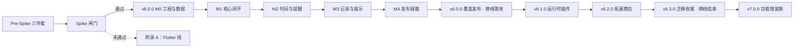

# 任务管家 V5 · 路线图

> 更新：2026-10-19　｜　当前版本：**v5.5.26**（已发布）　｜　当前动作：**Spike（进行中，结论即闸门）**　｜　目标形态：**v6 换栈 → v7 功能增发**
> 读者：项目作者 + AI 助手。本文件只回答三件事：**现在做什么、为什么现在做、做完怎么算完成**。
> 配套：`CLAUDE.md`（怎么干活：命令/环境坑/纪律）、`docs/decisions.md`（为什么这么定）。三者互不复述。

**目录**： [0 速览](#0-一页速览) · [1 现状](#1-现状事实基线) · [2 北极星](#2-北极星目标定义) · [3 迁移](#3-迁移从-flutter-到-rn) · [4 版本与节奏](#4-版本与节奏) · [5 版本计划](#5-版本计划) · [6 依赖图](#6-依赖与顺序) · [7 风险](#7-风险登记册) · [8 决策留档](#8-决策留档) · [9 已定口径](#9-已定口径与默认策略) · [附录](#附录-aflutter-退路spike-未过时启用)

---

## 0. 一页速览

| 项 | 内容 |
|---|---|
| 产品 | 「任务管家」：任务 / 积分 / 商城 / 番茄钟 / 统计 / 刮刮乐 / H5 小游戏；**纯本地无后端**，自签分发给小圈子，不上架商店 |
| 现在 | v5.5.26（Flutter，arm64 23.83MB，838 个用例全绿）；**没有新功能在开发**，全部产能压在迁移验证上 |
| 北极星 | **功能即插件（按需安装）+ 改界面不用发版** |
| 关键结论 | Flutter 的 AOT 让「热更原生界面」不可能 → **换 React Native + 自建 OTA**（2026-10-19 决策） |
| 当前动作 | **Pre-Spike 三件套（并行）+ Spike（约 2 周）**，出「走 / 不走」的结论 |
| 唯一的不可逆点 | **v6.0.0 覆盖发布那一刻**。在此之前每一步都能退，退的代价是已投入的时间 |
| 体积 | **15–40MB 即合格**（当前 23.83MB 已合格）。体积不是目标，只是护栏 |
| 最大风险 | ① Spike 不过（损失一个 Spike 的工作量）② 数据迁移丢数据 ③ v6 发布后无法退回 Flutter 版 |
| 明确不做 | APK 二进制差分、文件级增量、双运行时常驻、上架应用商店、为体积开版本 |

---

## 1. 现状（事实基线）

### 1.1 产品与用户

一个给自己和小圈子用的任务管理应用，核心是「完成任务 → 得积分 → 换奖励」的闭环，外加番茄钟与轻娱乐（刮刮乐、H5 小游戏）。**没有账号、没有云同步、没有后端**；数据只在本机，分发靠公开 GitHub 仓库 + CDN（v5 为 `Aria-2676/note_study`，v6 为 `Aria-2676/taskmaster-v6`），用户手动装 APK。这决定了三件事：

1. **没有商店兜底**——发错版只能自己回滚，所以发布链路必须有止血手段；
2. **用户量小**——可以不追新框架、不追商店合规，但也没有「上架后自动更新」的红利；
3. **数据在用户手里**——任何一次迁移，丢数据的代价都是不可挽回的口碑。

### 1.2 技术现状

| 项 | 值 |
|---|---|
| 框架 / 语言 | Flutter（stable）/ Dart，SDK `^3.11.1` |
| 规模 | `lib/` 220 个 Dart 文件、约 3 万行；`test/` 63 个文件、**838 个用例** |
| 模块（12） | tasks、tag、points、shop、pomodoro、statistics、calendar、scratch、games、profile、help、others |
| 存储 | sqflite，`v5_tasks.db`，`AppConfig.dbVersion = 3`；统计与设置走 SharedPreferences |
| 构建链 | AGP 8.11.1 / Gradle 8.14 / Kotlin 2.2.20；分 ABI 构建（`--split-per-abi`） |
| 包名 / 签名 | `com.noteapp.taskmaster`；keystore 刻意放在仓库外，丢失不可恢复 |
| 分发 | 公开仓库 `Aria-2676/note_study`（v5 仓库）+ jsDelivr 多节点 + GitHub Contents API 兜底；APK 走 GitHub Releases |

**架构上已经成立的事实**：12 个模块之间**零跨模块 import**；`core` 不依赖 `modules/*`。**但「可插拔」并不成立**——组合根、路由表、others 入口三处都是编译期直引：

- `lib/main.dart` 直接 import 8 个模块文件，根 `MultiProvider`（第 95 行起）硬编码创建 11 个 Provider；
- `lib/core/router/app_router.dart` 15 条 import 中 14 条是 `modules/*` 页面直引；
- `lib/modules/others/pages/others_page.dart` 直引 4 个模块页并用 `Navigator.push` 硬跳转。

### 1.3 分发与更新（现有能力，迁移后要重建）

| 机制 | 现状 | 迁移后 |
|---|---|---|
| 整包更新 | 多源下载 APK → sha256/大小校验 → 唤起安装器；五档决策（forced / optional / available / assetsOnly / none） | **只在原生模块变更时使用** |
| 资源热更 | 热更 zip → 校验 → 原子替换目录（`HotAssetStore` 唯一读入口） | 由 **OTA bundle** 取代大部分场景 |
| 小游戏包 | H5 zip 按需下载，WebView 加载，离线可玩 | 直接沿用为 RN 的 H5 拓展 |
| 回滚 | 目前手工改 `Aria-2676/note_study`（v5 仓库）的 `update.json`；v5.5.29 计划做一键脚本 | v6 OTA 自带「指回上一 bundle」 |
| 发版 | `tool/release.ps1` → 构建 → `publish_release.ps1` → 清单 → push → purge | 重写为 bundle 发布 + 灰度 |

### 1.4 体积口径（护栏，不是目标）

- **合格区间：M1 15–40MB**；当前 arm64 **23,830,599B（23.83MB）已合格**。**>40MB 才启动优化**；区间内不为省一两 MB 开版本，也不让它影响技术选型。
- **M1**：单 ABI release APK 字节数（只认 Release 资产的 `sizeBytes`，禁止手填）。
- **M2**：M1 − `lib/<abi>/libflutter.so`。`.so` 在包内 STORED，可直接相减；**禁止用 `unzip -l` 的 `file_size` 求和**（deflate 与 STORED 混用会得出 25,254,651 ≠ M1）。
- **M3**：`libapp.so` —— 判断「代码是不是写胖了」的唯一信号。

**基线（v5.5.26 arm64 Release，sha256 `f29112ce…`）**：M1 23,830,599｜`libflutter.so` 11,747,864（49.3%）｜M2 12,082,735｜M3 8,848,264（占 M2 73.2%）。

> `Aria-2676/note_study`（v5 仓库）里的 `releases/*.apk` 是 v5.5.21 旧产物，**不能**拿来测基线。另外：拆包最多只能减 M2 的 0.4–1.5MB，任何「瘦一半」的预期都不成立。

---

## 2. 北极星（目标定义）

### 2.1 一句话目标与四条铁律

**把功能做成插件，按需安装；同时做到改界面不用发版。**

1. **目标优先于排期**：版本号与顺序都是可调参数，北极星不是。
2. **做不到就顺延，不缩水**：宁可整体后移，也不能为了守住某个号而砍掉朝目标的增量。
3. **任何版本都要留增量**：不允许纯消费版本；内容版也要说明它为什么必须现在做。
4. **新功能先过准入判据**（2.5）：妨碍大方向的，排后或改造后再做。

### 2.2 能力阶梯

| 级 | 用户看到什么 | 技术手段 | 代价 | 落地 |
|---|---|---|---|---|
| **L0 全量包** | 装一次全都用；能变的只有皮肤与素材 | 资源热更 + H5 包 | 改任何界面都要发整包 | 现在 |
| **L1 可开关** | 关掉不用的功能，入口消失、数据还在 | 注册表 + 懒创建 + 路由守卫 | 不省一字节 | —（被 L4 取代） |
| **L2 资源/H5 拓展** | 商店下载 → 立刻可用；卸载 → 入口消失 | `AssetUpdatePackage` 原子落盘 + WebView | 只承载 H5 与素材，原生界面装不进来 | —（降级为 L4 的一部分） |
| **L3 多产物** | 装轻量版或全量版，首次安装更小 | flavor + `--dart-define` 编译期裁剪 | 换包要重下 20MB+；收益上限 1.5MB | 条件启用（附录 A） |
| **L4 插件 + 热更** | **装什么有什么，改界面不用发版** | **换栈：RN + Re.Pack 运行时插件 + 自建 OTA** | 重写约 3 万行；一次性覆盖安装；**不可回退** | **v6** |

> L1/L2 在 Flutter 里本来是合理的阶段目标，但换栈决策让它们变成「会被重写的中间态」——所以不再单独排版本，能力直接并入 L4。

### 2.3 为什么 L4 必须换栈

- release 的 `libapp.so` 是 ELF AOT 快照，release VM **不读 kernel、无 JIT** → 运行期没有加载新 Dart 代码的入口；
- 官方唯一的按需下发机制 deferred components 依赖 `play_core` + Play Feature Delivery，**自签 sideload 拿不到 `SplitInstallManager`**；
- `Isolate.spawnUri` / `dart:mirrors` 在 AOT 下均不可用。

结论：**Flutter 里能做到的上限就是 L3（编译期分装）**，它不是插件，只是「按需选包」。

### 2.4 目标栈与双车道

- **RN bare + New Architecture + Hermes**（New Arch 自 0.82 起为强制，Hermes 冷启动更优）。
- **运行时插件**：`Re.Pack` Module Federation —— `ScriptManager` 在运行期拉 remote bundle 并渲染，这是「装一个功能」的真语义。
- **热更通道**：v6 在 `Aria-2676/taskmaster-v6` 独立托管 bundle 与 `manifest.json`；清单契约沿用 v5 的 version/build/url/sha256/sizeBytes/mirrors 模型，走 **GitHub Releases + jsDelivr 多节点**。**不引入 Hot Updater 服务端**（省一台服务器与第三方依赖）。若将来需要灰度看板，再单独评估。
- **清单隔离是硬规则**：v6 **绝不读取或复用** `Aria-2676/note_study`（v5 仓库）的 `update.json`。`src/ota/updater.ts` 的 `checkForUpdate(baseUrl, appVersion, localBuild)` 固定请求 `${baseUrl}/manifest.json`，其中 `baseUrl` 由 `App.tsx` 的 `OTA_BASE_URL` 决定；当前值 `http://127.0.0.1:8099` 只用于验证，正式发版前必须替换为 v6 的真实 CDN 基地址。把 v5 整包清单交给 v6 当 bundle 清单解析会因契约不同而失败。
- **不走 CodePush**：App Center 2025-03-31 关停、仓库 2025-05-20 归档，且原客户端不支持 New Architecture。

**双车道 → 三条腿（v6.0.0 起必须齐备）**：换栈之后，原来那套 Flutter 更新器就不存在了，新应用必须自带完整更新能力；否则第一个 v6 会变成「再也送不到用户手里」的孤岛。

| 通道 | 承载 | 失效后果 |
|---|---|---|
| **OTA bundle**（日常） | JS / 界面 / 业务逻辑 / 文案 / 资源 | 只是这次没热更，不影响使用 |
| **整包 APK**（原生车道） | 新增原生模块、权限、小组件结构、SDK 升级；OTA 故障时兜底 | 原生能力再也加不上；OTA 坏了只能手动装包 |
| **内置 bundle**（兜底） | 下载包校验失败 / 连续启动崩溃 → 回落包内自带版本 | 一次坏 bundle 可能让所有人打不开应用 |

自签 Android 不受 Apple 对 OTA 的规则约束；若将来做 iOS 上架，另按 Apple 规则评估。

### 2.5 功能准入判据

新功能立项前逐条过，**任一命中即先改造或排后**：

1. **只做原生 UI、又不属于核心闭环的重模块**（记账、习惯打卡、白噪音等）→ 会永久占用原生包，先想清楚是否做成 H5 拓展。
2. **加深主包对模块的编译期依赖**（根 `MultiProvider` 直接 new、路由表直引、页面直引）→ 改造后再做；L4 之后这条应当自然消失，若又出现说明架构在退化。
3. **必须常驻核心界面的横切能力**（账户体系、云同步、实时协作）→ 会把网络/推送依赖拖进核心，先定「核心包依赖白名单」。
4. **直接拒**：任何依赖商店分发能力的 SDK（`play_core`、Play Services 动态特性）。

---

## 3. 迁移（从 Flutter 到 RN）

### 3.1 唯一不可逆点是「发布」，不是「开工」

- 开工、Spike、逐屏重写——**全都可以随时停**，Flutter 版继续服务用户。
- 只有 **v6.0.0 覆盖发布那一刻**不可逆：同包名 + 同签名 + 更高 versionCode，versionCode 不能降级，发出去就回不到 Flutter 版。
- 所以：**所有验证必须在发布前做完**，发布后再发现问题只能向前修。

**第一次升级怎么送到用户手里（不能走热更）**

- **资源热更做不到**：现有 `hot_assets` 只替换 `theme.json`、游戏包、图标这类**文件**，由 `HotAssetStore` 读取；它不加载代码，更不可能把 Flutter 引擎换成 RN 运行时。跨运行时只能装新包。
- **但可以复用 v5 整包更新通道（仅此一次）**：把完整的 v6 APK 上传到 `Aria-2676/taskmaster-v6` 的 GitHub Releases，再修改 `Aria-2676/note_study`（v5 仓库）的 `update.json` 中 `latest.version` 与 `downloads`，5.5.26 客户端照常「检查更新 → 多源下载 → 校验 → 唤起安装器」。这是 v5 通道最后一次被使用，推送的是**完整 APK，不是 JS bundle**；安装 v6 后，日常 OTA 只读 v6 自己的 `manifest.json`。
- **用户感知是一次普通更新，不是重装**：同签名覆盖安装，数据留在私有目录（`/data/data/com.noteapp.taskmaster/databases/v5_tasks.db`）。
- **硬条件：versionCode 必须显式抬高**。当前 `pubspec.yaml` 是 `5.5.26+0`，即 versionCode = **0**；v6 必须给一个真实递增号（如 `6.0.0+60000`），否则部分 ROM 对「同 versionCode 覆盖安装」的处理不一致。
- **分发节奏**：先按 `optional` 放出去（用户可选、可不装），观察崩溃率与迁移成功率（**以指标达标为准，不设天数**），稳定后再把 `minSupported` 抬到 6.0.0 收口。**不要在发布当天就 forced**——那等于把唯一的不可逆点变成一次全员赌博。

### 3.2 五步走（切换是原子的，工作不是）

```
① Pre-Spike 准备（并行，约 1 周）
② Spike（约 2 周，出结论）
③ 逐屏 parity（2–4 个月，RN 工程内增量推进，每个里程碑可停）
④ 灰度切主包（v6.0.0，一次性覆盖）
⑤ OTA 常态（此后改界面不发版）
```

两端运行时不共存：让 FlutterEngine 与 ReactActivity 同住一个 APK 要 +15MB 左右、两套导航与状态，solo 维护不值，**没有中间形态**。

### 3.3 Pre-Spike 三件套（与栈无关，收益最高）

1. **冻结 schema**：把 `v5_tasks.db`（`dbVersion = 3`）的表结构、字段语义、索引写成文档，作为两个世界之间唯一的数据契约。此后**任何 schema 变更都要同步更新这份文档**。
   - ✅ 已落盘：`docs/migration/schema-v3.md`（14 张表、8 条索引、枚举取值、7 条迁移不变量、5 条验收 SQL、待实测清单）。
2. **金样本**：用当前真实数据导一份包含「循环任务 / 积分流水 / 统计缓存 / 回收站 / 刮刮乐彩票」的样本库，作为迁移回归的**固定输入**。没有它，「数据零丢失」只能靠感觉。
   - **它只是测试基准，不随 App 发布，用户接触不到。**
   - **正式升级不吃金样本**：同包名 + 同签名覆盖安装，应用私有目录不变，用户那份 `v5_tasks.db` **原地迁移**，用户不需要导出/导入任何东西。
   - 只有在 **Spike 阶段**（测试包换了包名、沙箱读不到旧目录）才需要把金样本导进去做验证——这是开发环境的手段，不是产品流程。
   - ✅ 已落盘：`tool/make_golden_sample.py` + `fixtures/golden-v3.db` + `fixtures/golden-v3.expected.json`（12 张表、含孤儿 `task_tags`、NULL 状态票据、月末边界、emoji/超长文本；样本已 gitignore）。
3. **业务规则清单**：积分结算、循环实例生成（`loopId`）、统计节流（含「回合最终值必须无条件下沉」）、刮刮乐出票原子性。**这些是重写时最容易悄悄走样的部分**，UI 反而好办。
   - ✅ 已落盘：`docs/migration/business-rules.md`（加分/冲销/逾期扣分的顺序与幂等、15 天生成窗口、同 loop_id+同日去重、5 秒节流与终局例外、购票同事务、内存幂等风险、5 项待核实）。

### 3.4 Spike 闸门（一次性，约 2 周）

**范围**：任务列表读写 + 番茄钟前台计时 + 1 个桌面小组件 + OTA 全链路（上传 → 端内下载 → 重启生效 → 回滚上一版）。

| # | 验收项 | 判定 |
|---|---|---|
| 1 | 读现有 `v5_tasks.db`（或金样本导入） | 数据零丢失，字段逐个对得上 |
| 2 | OTA 真机生效 | 重启后是新 bundle，且能回滚到上一版 |
| 3 | 桌面小组件 | 真机可用，数据与主应用同步 |
| 4 | 通知 | 到点响，杀进程后仍响 |
| 5 | 冷启动 | ≤ Flutter 版 **1.5 倍**（记录实测值） |
| 6 | 包体 | 记录即可，**不作否决项** |

**四条否决线**（任一命中即判失败）：OTA 无法稳定生效｜数据迁移丢失｜小组件或后台提醒不可用｜冷启动超过 1.5 倍。

**实测进度**（真机 PCAM00 / Android 11 / arm64，包名 `com.noteapp.taskmaster.spike`）：

| # | 验收项 | 结果 |
|---|---|---|
| 1 | 读 `v5_tasks.db` | ✅ PASS（12 表行数、余额=流水=250、孤儿 1、时间格式 0 异常、`integrity_check=ok`） |
| 2 | OTA 真机生效 | ✅ 下载→校验→原子替换→重启生效→回滚，全链路通过 |
| 3 | 桌面小组件 | ✅ 桌面显示 2 / 1 / 250，与库一致；数据变更后可主动刷新 |
| 4 | 通知 | ✅ 排定后自杀进程，仍到点响（ColorOS 需手动开启通知） |
| 5 | 冷启动 | ✅ **RN release 382ms vs Flutter release 608ms（0.63×）**，未触 1.5 倍否决线 |
| 6 | 包体 | ⚪ 记录：RN 通用包 62.9MB（单 arm64 估算 ≈ **29.8MB**）vs Flutter 通用包 64.8MB（单 arm64 实测 23.8MB）。落在 15–40MB 合格区间，**不作否决项** |

否决线目前**零命中**。

**关于第 5 项的口径（别误读）**：Spike 的 RN 壳只渲染一个控制台，Flutter 侧是完整产品，
两者不是同等复杂度。这组数字证明的是「**RN 运行时启动开销本身不构成否决**」，
不等于 v6.0.0 的成品冷启动就一定更快——**M4 必须用真实 parity 应用重测一次**。
（附：RN **debug** 包 + Metro 冷启动 1.18s，是 Flutter release 的 1.87 倍——
拿 debug 比 release 会得出完全相反的结论，这个坑记在这里。）

**分支**：
- **通过** → 冻结 Flutter 新功能，进 v6.0.0；结论写入 `docs/decisions.md`。
- **未通过** → 解冻附录 A 的 Flutter 路线；同样把结论与实测数据写入 `docs/decisions.md`，避免半年后重走一遍。

### 3.5 功能保留清单（parity checklist，v6.0.0 的验收底稿）

| 功能 | RN 侧方案 | 类型 |
|---|---|---|
| 任务 / 标签 / 积分 / 商城 / 回收站 | TypeScript 重写（状态层 Zustand 或等价） | 重写 |
| 番茄钟后台计时 | Headless JS + 前台服务 | 需自写原生模块 |
| 通知 / 定时唤醒 | notifee + AlarmManager / WorkManager | 需自写原生模块 |
| 桌面小组件 / App Shortcuts | AppWidget + 原生模块桥 | 需自写原生模块 |
| SQLite（`v5_tasks.db`） | op-sqlite 直接打开同一 db（迁移前强制备份） | 可直接对应 |
| 统计 / 日历 | 图表库或自绘 | 需重设计 |
| 刮刮乐 | Canvas / Skia 自绘 | 需重设计 |
| H5 小游戏 | react-native-webview + 本地文件服务 | 可直接对应 |
| 分享 / 震动 / 音频 / 导入导出 | RN 社区库 | 可直接对应 |

### 3.6 为什么不能拖（拖得越久越难）

- **schema 漂移**：每加功能可能 `dbVersion +1`，RN 侧要重放整条迁移链，链越长越容易丢数据。
- **双写**：新功能要先 Flutter 写、再 RN 写，同一需求付两次钱。
- **沉没成本反噬**：Flutter 线投入越多越舍不得扔，最后变成「再等等」——这是最现实的风险。
- **结论**：Spike 一过就切，不先做 Flutter 新功能；Spike 未过只损失一个 Spike 的工作量。

---

## 4. 版本与节奏

### 4.1 版本号语义

**major 是「阶段边界」，不是「工作量大小」**。所以本项目这样切：

| 阶段 | 含义 | 版本 |
|---|---|---|
| **v5.x** | Flutter 时代：修补与（若 Spike 未过）退路 | v5.5.27–v5.7.0（见附录 A） |
| **v6.0.0** | **换栈落地**：RN 承接全部功能 + OTA 上线，用户只需装这一次 | v6.0.0 |
| **v6.x** | **换栈收尾**：运行时插件 → 拓展商店 → 迁移清账，Flutter 遗留逐项下线 | v6.1.0–v6.3.0 |
| **v7.0.0** | **换栈彻底结束**：进入功能增发与插件维护期，新功能默认以插件形态交付 | v7 起 |

| 位 | 承载 | 本项目实例 |
|---|---|---|
| **major** | 阶段边界（不可逆或改变交付方式） | v6.0.0 换栈、v7.0.0 增发期起点 |
| **minor** | 阶段内的可感知里程碑 | v6.1.0 插件、v6.2.0 商店、v6.3.0 收尾 |
| **patch** | 单主题小步：修 bug、工具链、发布工具 | 常态 |

**顺延规则**：任何一版做不完就整体后移一个号，**目标不缩水**；重排时在附录 B 留映射，避免历史引用悬空。

### 4.2 版本类型

| 类型 | 判定 | 自检 |
|---|---|---|
| **看得见版** | 至少一条改动让不进设置页的用户直接感知 | 「截两张图，他能说出差别吗？」 |
| **基建版** | 外部可观察行为不变，或只落在失败/弱网/发版路径 | 「用户装了会问『变了吗』吗？」 |
| **还债版** | 不产生新能力、只延长项目寿命 | 「不做会死吗？不会 → 可延后」 |

节奏：**两版内必有一版看得见**；连续基建不超过 2 个版本（同一主题的上下集算一个）。

### 4.3 通用质量门

**Flutter 线（当前）**
1. `flutter test --no-pub` 全绿，用例数只增不减（当前 838）；
2. `flutter analyze` 0 error，warning 不高于基线；
3. 真机走完「安装 → 主流程 → 覆盖安装升级」；
4. `publish_release.ps1` 跑通，`Aria-2676/note_study`（v5 仓库）的 `update.json` 中 sha256 与资产一致，回滚手段可用；
5. 本机若遇 `CreatePipe ERROR_PIPE_BUSY 231`（环境问题，不是代码问题），按 skill `flutter-offline-verification` 做替代验证，并在结论里注明**覆盖不到平台插件层与 UI 层**。

**RN 线（v6 起）**
1. 业务规则单测（积分结算、循环生成、统计节流、刮刮乐出票）+ Maestro E2E（任务闭环、番茄钟、拓展装卸）；
2. parity checklist 逐项打勾，缺一项不发版；
3. 冷启动 ≤ Flutter 版 1.5 倍；
4. 一次覆盖安装验证：旧 Flutter 版 → v6.0.0 → OTA，三步数据完整；
5. M1 落在 15–40MB 内（>40MB 先查依赖与资源打包）。

**OTA 发布门**
- 先发 **20%** 用户，观察崩溃率与关键路径，再全量；
- 崩溃率超阈值**自动回滚**上一 bundle；
- bundle 绑定 app 版本区间，不允许跨 native 版本乱投；
- 保留最近 3 个 bundle 可回退。

### 4.4 节奏假设（非承诺）

**不设日历节点，只设出口**：每个版本 / 里程碑都以「出口条件」判定是否继续，不以日期判定。产能假设（单人、周末为主）只用于决定「要不要拆小」，不对外承诺；某个里程碑明显超出预期时，拆小或砍非核心，而不是加班。

---

## 5. 版本计划

> 原则：**只承诺最近一步**。v6.0.0 之后的内容只给方向、不写死日期——换栈后的真实速度要等 M0 跑完才知道；v6.3.0 与 v7.0.0 是阶段目标，不是承诺日期。

### 5.1 现在（无版本号）：Pre-Spike + Spike

- [x] schema 冻结文档（表 / 字段 / 索引 / 语义）→ `docs/migration/schema-v3.md`
- [x] 金样本：合成样本 + 期望值已生成（`tool/make_golden_sample.py`）；**真实数据待导出后替换**
- [x] 业务规则清单（积分结算 / 循环生成 / 统计节流 / 出票原子性）→ `docs/migration/business-rules.md`
- [x] RN bare 工程 + New Architecture + Hermes，跑通「读 `v5_tasks.db`」→ **真机 RESULT=PASS**（RN 0.88 / arm64 / Android 11；5 项全过：12 表行数、余额=流水、孤儿数、时间格式、integrity）
- [x] 通知（真机验证：排定后**自杀进程**，仍到点响；ColorOS 需手动开启通知）
- [x] 自建 OTA 最小闭环：上传 → 下载 → **校验（size + sha256）** → 原子替换 → 重启生效 → 回滚上一版 → **真机全链路通过**（889KB bundle，生效 build=2/6.0.2；回滚后回到包内版本，金样本仍 PASS；连续 3 次未标记健康自动回滚）
- [x] 桌面小组件（AppWidget，只读打开 `v5_tasks.db`）：真机已添加到桌面并显示 **待办 2 / 已完成 1 / 积分 250**，与库中数据一致；`updateWidgets` 主动刷新接线完成
- [x] 番茄钟前台计时：**真机通过**（倒计时 → 写记录 3→4 → 后台归零仍发通知 → 刷新小组件；`actual_seconds=60` 而墙钟跨度 86.9s，证明暂停时长被正确排除）
- [x] Spike 报告：6 项验收数值 + 4 条否决线判定 + 结论 → **`docs/decisions.md`「Spike 闸门结论」**：**通过（走），否决线零命中**

**出口**：Spike 结束时给出「走 / 不走」的明确结论，**不允许以「再试试」结尾**。

### 5.2 v6.0.0 ｜换栈重写 · RN + 自建 OTA　`基建版 + 看得见版`

> **为什么**：唯一能同时拿到「插件」和「改界面不用发版」的路径。留在 Flutter，改一行界面也要发 24MB 整包。
> **验收**：§3.5 parity 全绿；OTA 生效且可回滚；旧版覆盖安装数据完整；冷启动 ≤1.5 倍；M1 ≤40MB；**发布前必须用新应用自己的通道完成一次真实升级 + 回滚演练**（内置 bundle → OTA 新版本 → 回滚），并确认 APK 兜底更新检查可用。**这三条通道演练不过，不发版**——第一个 v6 一旦成为「送不到用户手里」的孤岛，后面所有版本都无从谈起。
> **北极星贡献**：`L4` 本体。
> **风险**：**不可回退**；原生模块变更仍需整包；重写约 3 万行的产能占用（量级：数月，按里程碑推进）。

| 里程碑 | 出口（可停点） |
|---|---|
| **M0** 工程与数据 | 金样本 100% 一致；否则不走 |
| **M1** 核心闭环 | 能日常自用一周 |
| **M2** 时间与提醒 | 杀进程后提醒仍响 |
| **M3** 记录与娱乐 | parity 清单过半 |
| **M4** 发布链路 | 三通道演练通过才发版 |

**每个里程碑都是一次「继续 / 放弃」的决策点**：M0 不过直接终止；M1 后做一次体感评审（不好用就别硬撑）；M4 前发现致命问题，回 Flutter 线，损失的只是已投入时间。

- [ ] M0：RN 工程 + DB 迁移 + 金样本回归
- [ ] M1：核心闭环（任务/标签/积分/商城/回收站/设置）
  - **两个子层，别当成一个进度**（2026-10-20 校准）：
    - [x] **数据层**：五个仓储 + 事务原语 + 类型定义（`src/repo/`）→ 类型检查 0 错误、纯逻辑单测 **84 条全绿**（2026-10-20 实测：`npm test` = 42 积分/循环/番茄钟 + 28 积分商城 + 14 回收站清理，退出码 0）
      - ⚠️ 这 84 条**不是 jest 用例**：`src/core/__tests__/` 下三个文件用自写的迷你运行器，必须 `npm test`（内部走 `node --experimental-strip-types`）来跑。直接 `npx jest` 会报「3 个套件全失败、0 用例」——曾因此误以为单测全挂。已用 `jest.config.js` 的 `testPathIgnorePatterns` 排除，并配了**反向测试**（注入失败断言 → `npm test` 必须返回 1）。
    - [ ] **功能接线**：状态层（Zustand）+ 界面层（任务/详情/编辑/标签/积分/商城/回收站/设置）+ 导航与真机冒烟
  - **数据层不等于模块完成**：仓储写完只说明「读写与事务正确」，**用户能看见、能操作、能闭环**才算这个模块完成。
  - 内部量级参考：数据层 ≈1/3、状态层 ≈1/6、**界面层 ≈1/2**、接线冒烟 ≈1/6。
- [ ] M2：番茄钟 / 通知 / 桌面小组件 / App Shortcuts
- [ ] M3：统计 / 日历 / 刮刮乐 / H5 游戏 / 导入导出
- [ ] M4：OTA（灰度 + 自动回滚）+ 内置 bundle 回退 + APK 兜底更新检查 / 覆盖安装验证 / parity 收尾

### 5.3 v6.1.0 ｜运行时插件　`基建版`

> **为什么**：热更解决「改得快」，插件解决「装不装」。Re.Pack MF 让一个功能以 remote bundle 形式装载，卸掉即入口消失。
> **验收**：把一个真实模块（建议刮刮乐或统计）做成 remote bundle；装 → 入口出现；卸 → 入口消失、本地缓存清空；宿主不重启崩溃率为 0。
> **北极星贡献**：插件的「真语义」落地。

- [ ] Re.Pack Module Federation 接入 + bundle 清单（id/version/entry/sha256/depends）
- [ ] 首个 remote 模块试点 + 装载/卸载/降级（加载失败回宿主内置页）
- [ ] 拓展契约文档：什么能做成拓展、什么必须留在宿主

### 5.4 v6.2.0 ｜拓展商店　`看得见版`

> **为什么**：用户可见的「应用内商店」——能自己选装。
> **验收**：首启引导自选；安装后入口即时出现（最多一次重启）；卸载后无残留；全部不装时核心功能完整。
> **北极星贡献**：把能力变成用户可感知的产品形态。

- [ ] 商店页 + 安装/卸载/更新 + 占用与版本信息
- [ ] 全部拓展不装时的「最小可用」回归
- [ ] 审计：安装来源、版本、失败原因可查

> **诚实边界**：RN 上的插件**不省包体**（JS 仍在 bundle 内），它省的是「入口与注意力」，以及让非核心功能可以独立迭代。若哪天体积逼近 40MB，再谈按需下发 JS（MF 已经具备这个能力）。

### 5.5 v6.3.0 ｜迁移收尾（换栈彻底结束）　`基建版`

> **为什么**：v6.0–v6.2 之后功能是新的，但周边还留着 Flutter 时代的尾巴——旧热更目录、旧清单字段、旧资源包、两套文案与图标。**不把「两套世界」收敛成一套，v7 的增发就要一直背双份包袱。**
> **验收**：parity 清单 **100%**（含刮刮乐细节、日历、统计维度、导入导出兼容）；Flutter 专有字段（`hot_assets`、`assetBuild`）从清单与代码中移除或明确弃用，OTA 成为唯一更新通道；Flutter 工程归档（打 tag、主分支停止构建、保留可回溯产物）；`grep -r "flutter"` 只剩历史文档与归档说明。
> **北极星贡献**：把「换栈」从进行时变成完成时——**这一版之后才叫 v7**。

- [ ] parity 剩余项补齐（刮刮乐细节、日历、统计维度、导入导出格式兼容）
- [ ] 清单与代码清账：Flutter 专有字段下线，OTA 成为唯一更新通道
- [ ] Flutter 工程归档：tag + 主分支停止构建 + 保留可回溯产物
- [ ] 插件维护 SOP：新增/更新/下架的流程与回滚演练

### 5.6 v7.0.0 ｜功能增发期（换栈结束后的第一版）　`看得见版`

> **为什么**：v6 整条线都在「把旧东西搬过来」；v7 起才是「在新地基上加东西」。热更已是常态，新功能可以按插件交付，不必为发版攒批次。
> **验收**：至少 1 个新功能以插件形式上线且不随主包发版；主包 M1 不因新功能增长（>40MB 才处理）；插件更新对用户无感（下次启动生效）。
> **北极星贡献**：目标从「能不能热更」转为「热更之后怎么更快地长出功能」。

- [ ] 首批由备选池产出的新功能（按 §2.5 判据逐条过）
- [ ] 插件市场与更新机制常态化（版本、兼容区间、下架策略）
- [ ] 体验优化：启动、列表滚动、主题与动效

---

## 6. 依赖与顺序



**硬前置**：Pre-Spike 三件套 → Spike（没有金样本就无法判「数据零丢失」）；M0 → M1 → M2 → M3 → M4 → 发布；**v6.0.0 发布之后才谈插件与商店；v6.3.0 清完账才进 v7**。
**软约束**：v6.1.0 可与 M3 的部分工作并行准备，但不要在 v6.0.0 未发布前动线上代码。

---

## 7. 风险登记册

| 风险 | 触发信号 | 应对 |
|---|---|---|
| Spike 未过 | OTA 不稳 / 冷启动 >1.5 倍 / 小组件不可用 | 回 Flutter 线；结论落盘，损失一个 Spike 的工作量 |
| 数据迁移丢失 | 金样本字段对不上、计数不符 | M0 直接终止；迁移前后强制备份 + 逐表校验 |
| v6 发布后无法回退 | versionCode 已升、线上崩溃 | 发布前灰度、崩溃率阈值、保留 Flutter 版 tag 与产物；发布采用分阶段（先小范围） |
| 单人产能不足 | 连续两个里程碑明显超出预期 | 拆小里程碑或砍非核心（刮刮乐/游戏最后做） |
| RN 生态踩坑 | New Arch 兼容问题、依赖强制升级 | 固定版本、最小依赖、每个原生模块单独 Spike |
| 沉没成本反噬 | 「再做完这个 Flutter 功能就切」 | 铁律：Spike 通过即冻结 Flutter 新功能 |
| v6.0.0 自带更新通道没做全 | 发版前从未做过真实 OTA 演练 | 三通道演练作为发布门；演练不通过不发版 |
| OTA 事故 | 坏 bundle 导致白屏 | 灰度 20% + 自动回滚 + 保留 3 个历史 bundle |

---

## 8. 决策留档

### 8.1 已定决策

| 日期 | 决策 | 理由 |
|---|---|---|
| 2026-10-19 | **换栈到 RN + 自建 OTA** | Flutter AOT 无法热更原生界面；作者要求「能热更给用户」。代价是一次性重写，收益是此后不再为改界面发整包 |
| 2026-10-19 | **体积降级为护栏（15–40MB）** | 现状 23.83MB 已合格；体积不参与选型与排期 |
| 2026-10-19 | **先 Spike 再重写** | 唯一不可逆的是发布；把验证放在发布前 |
| 2026-10-19 | **不做双运行时共存** | +15MB 与两套导航状态，solo 维护不值 |

### 8.2 已评估不做

- **APK 二进制差分（BSDiff/Courgette）**：不做。① Android 10+ SELinux 禁止普通自签应用读取已安装的 `base.apk`，patch 无旧包可打；② Flutter `libapp.so` 为 AOT 机器码，小改也整体重排，压缩率不稳；③ 瓶颈是连通性不是体积。**重议触发**：单包 >60MB 且持续两版压不回（注：40MB 是启动优化的护栏，60MB 才是重议差分的门槛）。
- **资源包文件级增量**：暂缓。热更/游戏包均 1MB 级，增量不抵成本。**重议触发**：任一 asset 包 >10MB。
- **L3 多产物（Flutter 编译期分装）**：**条件启用**。体积已非必需，仅在 Spike 未过且确实需要更小包时做；否则不做，见附录 A。
- **上架应用商店**：不做。自签小圈子分发，上架意味着合规、审核与 OTA 规则全面收紧。

---

## 9. 已定口径与默认策略

### 9.1 已定（作者拍板）

| # | 事项 | 定论 |
|---|---|---|
| 1 | **平台范围** | **Android 是唯一承诺平台**（真实用户都在自签 Android）。iOS 单独立项，不阻塞 v6。**Web 作为可选后续**：`react-native-web` 可复用 UI，但数据层要另做（无 SQLite）、OTA 也不适用，因此不进 v6 范围。桌面（macOS / Linux / Windows）放弃，Flutter 版归档后人肉可用 |
| 2 | **OTA 托管** | v6 的 bundle 与独立 `manifest.json` 托管在 `Aria-2676/taskmaster-v6`，走 **GitHub Releases + jsDelivr 多节点**（1–3MB，远低于 20MB 上限，链路已验证）；清单契约沿用 v5 的 `version/build/url/sha256/sizeBytes/mirrors` 模型，但**不复用** v5 仓库的 `update.json`。**不引入 Hot Updater 服务端**——省掉一台服务器和第三方依赖 |
| 3 | **Spike 的真实数据** | **不靠同包名直读**（Android 沙箱隔离，换包名就读不到私有目录）。改用**金样本导入**：导出 → `adb push` 到 RN 应用目录或首启导入文件 |

### 9.2 数据与隐私

- 真实数据（`tasks.db`——v6 的库名；v5 那份叫 `v5_tasks.db`；以及导出的 JSON）**只在本机 `$TEMP` 或私有目录处理，绝不入库**。`Aria-2676/taskmaster-v6` 是公开仓库，且推送走 API 直推 `main`——**没有 PR 审批这一关，提交即公开**。
- 同理，PAT 也绝不入库：`tool/github_token.txt` 已在 `.gitignore` 里（推送脚本会读它）。
- `.gitignore` 已排除：`*.db`、`*.sqlite`、`*.sqlite3`、`/fixtures/`、`backup-*.json`、`export-*.json`。
- 任何进入仓库的样本必须**脱敏**：只保留结构与边界特征（空值、超长文本、emoji、时区跨日、无限循环任务），不保留真实任务文案与时间分布。

### 9.3 默认策略（不阻塞开工，遇到再翻）

- **过渡期 bugfix**：只修阻断级，登记「待移植清单」，随 M 里程碑批量带过去，不双写。
- **旧版支持窗口**：v6.0.0 发布后保留 2 个 v6 版本周期，再抬 `minSupported`（按版本数，不按日期）。
- **v6.1 / v6.2 可延后**：先只做 v6.0.0；自用一段时间后判断是否真的需要「装/卸功能」，需要再做。

---

## 附录 A：Flutter 退路（Spike 未过时启用）

> 仅在 Spike 判定「不走」时解冻。**详细验收口径见本文件改写前的 git 历史**；下表保留计划骨架，避免重做规划。

| 版本 | 主题 | 类型 | 核心内容 |
|---|---|---|---|
| v5.5.27 | 主题画廊 | 看得见 | 6–8 套预设（亮/暗）+ 外观页选择器 + 持久化；热更优先、无包回落本地 |
| v5.5.28 | 核心页面 UI 打磨 | 看得见 | 任务卡视觉层级、番茄钟大圆环、统一空态；**analyze warning 归零**（此后保持） |
| v5.5.29 | 发布安全网 | 基建 | 清单一键回滚（≤3 分钟）、强制更新不可取消链路验证、发版前 E2E 自检 |
| v5.5.30 | 技术栈升级 | 还债 | AGP 9.0.1+ / Gradle 9.1.0+ / Kotlin 2.3.20+；签名不变；不得重新引入 `--no-tree-shake-icons` |
| v5.6.0 | 拓展框架（L1） | 基建 | `ExtensionRegistry` + Provider 懒创建 + 路由守卫；验收：跨模块 import 0 条、全关组合不崩 |
| v5.6.1 | 拓展商店（L2） | 看得见 | 清单 `extensions` 目录 + 原子落盘 + H5 壳；**裁决结论写入 `docs/decisions.md`** |
| v5.6.2 | 通知与小组件 | 看得见 | 前台服务常驻 + 精确唤醒 + 三类 widget + Shortcuts；限核心包内 |
| v5.6.3 | Todo 列表 | 看得见 | 新增 `lib/modules/todo/`；与任务模式不串数据；dbVersion +1 必须可迁移 |
| v5.6.4 | 循环任务管理 | 看得见 | 重复次数上限；提前完成剩余次数；兼容存量无限循环 |
| v5.7.0 | 多产物分装（L3） | 可选 | flavor 编译期裁剪 + 清单分键 + 跨产物换装；**体积非必需，优先级 P2** |

**启用时的不变量**：`core` 不依赖 `modules/*`；组合根、路由、入口三处的编译期直引必须换成注册表（否则 L1 只是开关页）；每版仍过 §4.3 的 Flutter 质量门。

---

## 附录 B：版本号映射（历史重排留痕）

| 旧号 | 现归属 | 说明 |
|---|---|---|
| v5.6.0 原 Todo 列表 | 附录 A v5.6.3 | 换栈线优先，Todo 后置 |
| v5.6.1 原循环任务 | 附录 A v5.6.4 | 同上 |
| v5.6.2 原模块解耦 | 附录 A v5.6.0 拓展框架 | 改为注册表 + 懒创建 + 路由守卫 |
| v5.6.3 原功能独立安装 | 附录 A v5.6.1 拓展商店 | L2 降为过渡产物 |
| v5.6.4 原通知/小组件 | 附录 A v5.6.2 | 同主题前移 |
| v6.0.0 原编译期裁剪 | 附录 A v5.7.0 多产物（可选） | 体积非必需，降为 P2 |
| v6.0.0 原拓展商店 | 主线 **v6.2.0 拓展商店** | 升到主线上，作为换栈后的插件化交付 |
| v7.0.0 原多产物 | 主线 **v7.0.0 功能增发期** | 阶段语义重定义：v7 = 换栈结束后的增发 |
| — | 主线 **v6.0.0 换栈** | 换栈决策新增；v6 系列自此专指换栈线 |

---

## 附录 C：已发布版本

| 版本 | 日期 | 主题 |
|---|---|---|
| v5.5.26 | 2026-10-17 | 资源/游戏包 Range 断点续传 + 多源回退、「仅 WiFi 自动下载」、更新结果统计、恢复图标树摇 |
| v5.5.25 | 2026-10-16 | 弱网下载修复（可重试识别 + 断点续传）、残留临时包清理、API 推送与一键发版 |
| v5.5.24 | 2026-10-16 | 分 ABI 构建、FileProvider 安装弹窗修复、多源镜像与下载进度通知 |

> `README.md` 的版本历史目前只到 V5.5.0，5.5.1–5.5.26 尚未补齐——**本表是该区间唯一记录**。

---

## 维护约定

- 每版发布：勾选 checklist → 更新 §0 的「现在」→ 附录 C 插一行。
- 改版本号：同步附录 B 映射，别让历史引用悬空。
- 篇幅基准：**正文 ≤440 行、含附录 ≤510 行**；超了先删重复叙述，**不删 checklist 与决策留档**。
- 任何「临时决定」都要落进 §8，而不是只在对话里说过。
